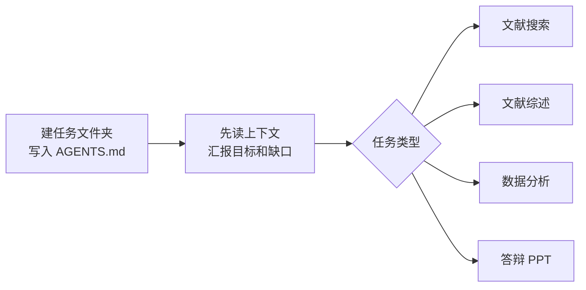

<p align="center">
  
</p>

# Codex 科研工作流

一个面向 [Codex](https://chatgpt.com/codex) 的科研任务 Skill。把 Codex 当成会执行的任务型 Agent，而不是聊天机器人：**一个任务一个文件夹，用 `AGENTS.md` 约束流程；先真实检索、真实跑代码，再写综述或做答辩 PPT。**

覆盖研究生最常见的四类工作：文献搜索、文献综述、问卷或实验数据分析、答辩 PPT。

方法论整理自兔老师（[@DrRabbitAI](https://x.com/DrRabbitAI)）的文章[《如何用Codex辅助我们做科研：从文献搜索到答辩PPT》](https://x.com/DrRabbitAI/status/2121590571689287967)。

## 它坚持的底线

- 不得凭模型记忆编造论文、DOI、PMID、统计数字或图表。
- 文献必须来自真实检索，或你提供的 PDF / 笔记。
- 统计结果和统计图必须由 Python 或 R 对真实数据跑出来，并保留代码。
- 不确定的信息标记为「待核查」，不要写成确定结论。
- 统计方法是否合适、结果如何解释，由研究者判断。Codex 负责写代码、跑分析、整理材料和打磨图表。
- 不要因为某个 Skill 很火就直接拿来写论文，先判断它的流程是否匹配你的学科和任务。

## 四条工作流



| 任务 | 正确顺序 | 不要这样做 |
| --- | --- | --- |
| 文献搜索 | 拆概念矩阵 → 生成检索式 → 真实检索 → 整理可核查文献表 | 直接问「请推荐 20 篇关于某某的论文」 |
| 文献综述 | 读真实论文 → 主题矩阵 → 大纲 → 正文 | 直接问「请帮我写一篇文献综述」，或引用不存在的文献 |
| 数据分析 | 数据体检 → 分析计划（先确认）→ 写代码并运行 → 必要时只美化图表 | 让大模型凭空画统计图，或不经体检直接推断 |
| 答辩 PPT | 拆答辩逻辑 → 大纲（先确认）→ 再生成 PPT 和讲稿 | 把论文复制进幻灯片，或编造论文里没有的数据和结论 |

每一步的产出都会写进文件夹，而不是只出现在对话里。可复制的分步提示见 [`assets/prompts.md`](assets/prompts.md)。

## 安装

任选一种方式。安装后请重启 Codex；若技能列表里还没有，再重启一次。

### 方式一：克隆到个人技能目录（推荐）

Codex 会读取个人技能目录。常见位置是 `~/.agents/skills` 和 `~/.codex/skills`，与你现有 Skill 保持同一目录即可。

macOS / Linux：

```bash
git clone https://github.com/121209/research-workflow.git ~/.agents/skills/research-workflow
```

若你平时把 Skill 放在 `~/.codex/skills`：

```bash
git clone https://github.com/121209/research-workflow.git ~/.codex/skills/research-workflow
```

Windows PowerShell：

```powershell
git clone https://github.com/121209/research-workflow.git "$env:USERPROFILE\.agents\skills\research-workflow"
```

克隆后应能看到 `SKILL.md`。如果目标目录已存在，不要覆盖你的本地修改。

### 方式二：放进某个仓库

把本仓库放到该项目的：

```text
.agents/skills/research-workflow/
```

在这个仓库里打开 Codex 即可使用。

### 方式三：在 Codex 里用 skill-installer 安装

```text
$skill-installer install https://github.com/121209/research-workflow
```

也可以直接对 Codex 说：

```text
请帮我从 GitHub 安装这个 Skill：
https://github.com/121209/research-workflow
安装后请先阅读 SKILL.md，告诉我它的流程、输入要求、输出格式和使用限制。
```

## 怎么用

在 Codex 里直接说，例如：

```text
按 research-workflow，帮我做一个文献搜索任务，主题是：生成式 AI 对研究生科研自我效能的影响。
```

```text
按 research-workflow 写文献综述，论文都在 papers/ 里。
```

```text
按 research-workflow 分析这份问卷数据。数据在 data.csv，变量说明在 variable-dictionary.md。
```

```text
按 research-workflow，根据终稿做答辩 PPT。论文在 final-paper.md，图表在 figures/。
```

Codex 应先建立任务文件夹、写入 `AGENTS.md`，并先汇报它理解的目标、已有材料和缺口，而不是立刻出最终结果。通用起步提示如下，进入任何任务文件夹后都可以先发这一条：

```text
请先阅读当前文件夹和 AGENTS.md，告诉我你理解到的任务目标、已有材料、缺失材料，以及下一步你建议执行的操作。先不要直接生成最终结果。
```

### 各任务的文件夹

文献搜索：

```text
literature-search/
├── AGENTS.md
├── topic.md
├── seed-papers.md
├── search-results/
└── notes/
```

文献综述：

```text
literature-review/
├── AGENTS.md
├── papers/
├── literature_matrix.csv
├── notes/
└── draft/
```

数据分析：

```text
data-analysis/
├── AGENTS.md
├── data.csv
├── variable-dictionary.md
├── scripts/
├── figures/
└── reports/
```

答辩 PPT：

```text
defense-ppt/
├── AGENTS.md
├── final-paper.md
├── figures/
├── tables/
└── ppt-output/
```

对应规则模板在 [`assets/`](assets/) 里，创建任务时可直接复制。

## 和其它 Skill 怎么配合

本仓库是工作流，不是检索引擎或 PPT 引擎。按学科需要，可以再安装专门工具，但**安装后先让 Codex 读它的 `SKILL.md`，确认适配再开工**。提示见 [`assets/prompts.md`](assets/prompts.md) 的「先读 Skill」。

| 场景 | 可以选用的工具 |
| --- | --- |
| 社科 / 教育 / 管理的文献检索 | 能真实检索的 Google Scholar 类 Skill |
| 医学 / 生物医学 / 公共卫生 | [pubmed-paper-finder](https://github.com/yilaai/pubmed-paper-finder)（走 NCBI，不编文献） |
| 已有论文列表，需要阅读优先级 | paper-quality-filter（按来源证据排序，不替你判断学术价值） |
| 答辩 PPT | [codex-ppt-skill](https://github.com/ningzimu/codex-ppt-skill)（图片式 PPT，出稿快但不易逐元素编辑），或 [stanford-lecture-ppt-skill](https://github.com/121209/stanford-lecture-ppt-skill)（可编辑讲义风 PPT） |

图表打磨只能基于同一份代码和同一份数据改配色、字体、标签和导出格式，不得改动任何统计结果。

## 更新已安装的副本

GitHub 上的更新不会自动同步到你电脑里已安装的 Skill。用 `git clone` 安装后，在对应目录执行：

```bash
git -C ~/.agents/skills/research-workflow pull --ff-only
```

如果实际路径是 `~/.codex/skills/research-workflow`，把上面的路径换掉即可。有本地修改时先备份再处理差异，不要强行覆盖。更新后如未出现在 Codex 中，重启一次。

## 仓库结构

```text
research-workflow/
├── SKILL.md                              技能入口、硬性规则和四条工作流
├── README.md                             本说明
├── LICENSE                               MIT
├── docs/banner.png                       README 封面
└── assets/
    ├── literature-search.AGENTS.md       文献搜索任务规则模板
    ├── literature-review.AGENTS.md       文献综述任务规则模板
    ├── data-analysis.AGENTS.md           数据分析任务规则模板
    ├── defense-ppt.AGENTS.md             答辩 PPT 任务规则模板
    └── prompts.md                        可复制的分步提示
```

## 致谢

工作流整理自兔老师（[@DrRabbitAI](https://x.com/DrRabbitAI) / [yila.ai](https://yila.ai/)）的公开分享[《如何用Codex辅助我们做科研：从文献搜索到答辩PPT》](https://x.com/DrRabbitAI/status/2121590571689287967)。本仓库把它改写成可安装的 Codex Skill 和可复用模板，便于在本地重复执行；如有解释上的出入，以原文为准。

本仓库不包含他人论文原文、数据集、私人笔记或第三方 Skill 源码。使用时请确保你对输入的论文、数据和图片拥有相应权限，并对研究结论自行负责。
